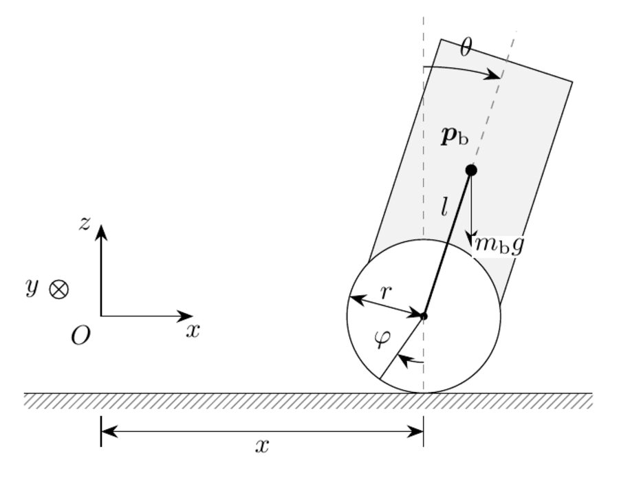
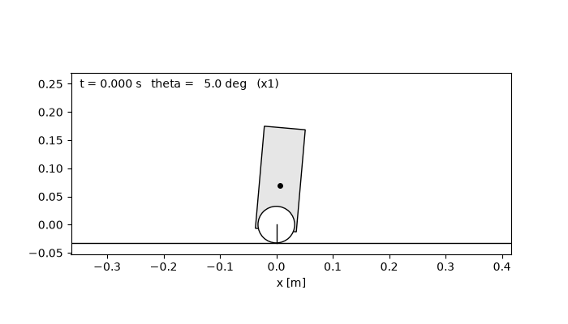
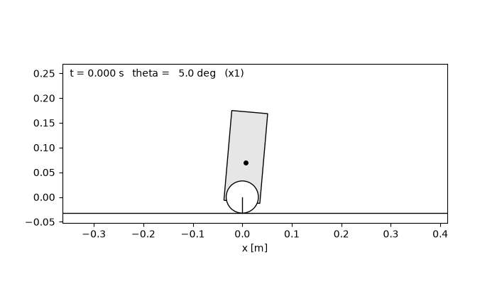

# Self-Balancing Robot

A low-cost two-wheeled self-balancing robot (ESP32, DC gear motors with encoders, MPU-6050),
built from first principles: the dynamic model, simulator, estimators and controllers are
written from scratch, without robotics libraries. The goal is a balance controller that
combines model-based control with a learned policy, robust to changes of the centre of mass.

<p align="center"></p>

## Done so far

- Planar dynamic model derived with the Euler–Lagrange method, in the form
  `M(q) q̈ + h(q, q̇) = B τ`, and checked symbolically ([report](report/main.pdf)).
- NumPy simulator: forward dynamics, explicit Euler and RK4 integrators.
- Physics-based test suite: mass matrix properties, equilibrium, agreement with the
  symbolic model, integrator order, energy conservation.
- First experiment: free fall with the motor off.
- Linearisation about the upright equilibrium, eigenvalues and controllability.
- PID on the tilt angle and LQR on the full state, tested on the nonlinear model: the PID keeps
  the robot upright but lets it drift, the LQR also brings it back to the starting position.

| PID on the tilt angle | LQR on the full state |
|:---:|:---:|
|  |  |

## Plan

- [x] Planar dynamic model (Lagrange)
- [x] Simulator and integrators, free-fall experiment
- [x] Linearisation and controllability
- [x] PID and LQR in simulation
- [ ] Motor model (torque limits, dead zone, delay)
- [ ] MuJoCo model and cross-validation
- [ ] Bench tests: IMU and encoder drivers, complementary and Kalman filters, motor identification
- [ ] 3D-printed frame, assembly, LQR on the real robot
- [ ] Steering (differential drive)
- [ ] Learned controller: PPO, domain randomisation, adaptation to centre-of-mass changes

## Quick start (WSL2 / Linux)

```bash
bash environment/setup_wsl.sh   # once
pip install -e ".[dev]"
pytest
python experiments/01_free_fall.py
```
